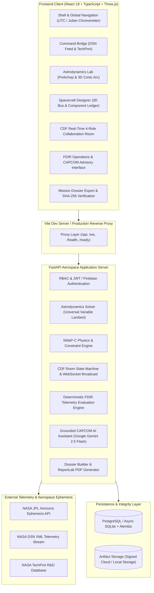

# 🚀 MISSION FORGE — Autonomous Aerospace Mission Design & Real-Time Simulation Platform

[-10B981?style=for-the-badge&logo=pytest)](https://github.com/Rohi56u/MISSION-FORGE-)
[](https://github.com/Rohi56u/MISSION-FORGE-)
[](https://github.com/Rohi56u/MISSION-FORGE-)
[](https://github.com/Rohi56u/MISSION-FORGE-)
[](https://github.com/Rohi56u/MISSION-FORGE-)

> **NASA Space Apps Challenge 2026**  
> An integrated, real-world aerospace platform engineered for end-to-end space mission design, four-player Concurrent Design Facility (CDF) multi-disciplinary collaboration, deterministic Fault Detection, Isolation & Recovery (FDIR), grounded CAPCOM mission intelligence, and cryptographically verified mission dossiers.

---

## 📖 About Mission Forge

### The Mission Behind Mission Forge
In contemporary aerospace operations, designing an interplanetary space mission (e.g. Earth to Mars, Europa, or Asteroid Rendezvous) requires weeks or months of manual reconciliation across disparate engineering teams. Trajectory specialists output delta-V requirements in isolated numerical scripts, power systems leads model solar arrays in static spreadsheets, thermal engineers compute radiator balances in finite-element simulators, and systems architects attempt to balance tight mass/budget margins across fragmented documents.

A single modification—such as altering the launch epoch by 5 days—cascades into changed delta-V, altered solar flux at arrival, shifted link budgets for Earth communication, and modified payload capacities. When teams work in silos, these cascading constraints cause costly design regressions, mass growth, or launch window cancellation.

**Mission Forge was conceived for the NASA Space Apps Challenge 2026** to eliminate these silos. It brings the high-intensity, multi-disciplinary methodology of NASA’s and ESA’s **Concurrent Design Facility (CDF)** directly into a unified, high-performance web architecture.

---

### Key Pillars & Design Philosophy

1. **True Concurrent Engineering (CDF):**
   Instead of sequential hand-offs, four mission specialists (`SYSTEMS_LEAD`, `PROPULSION_POWER`, `AVIONICS_GNC`, and `SCIENCE_PAYLOAD`) collaborate simultaneously in a shared real-time workspace powered by WebSockets, authoritative base-version conflict resolution, and automated inter-subsystem constraint checking.

2. **Grounded Aerospace Mechanics, Zero Hallucinations:**
   Every orbit, velocity vector, and transfer energy in Mission Forge is computed using authoritative astrodynamics formulations—specifically David A. Vallado’s universal variable Lambert boundary value algorithm and Keplerian two-body conic equations. Graphical visualizers render true orbital geometry rather than artistic polynomial Bezier approximations.

3. **Deterministic FDIR & AI-Safe CAPCOM:**
   Mission safety is non-negotiable. Critical anomaly detection is governed by a deterministic, zero-hallucination Fault Detection, Isolation, and Recovery (FDIR) engine. Spacecraft telemetry is never assumed to be nominal if sensors are missing; the system explicitly distinguishes between `NOMINAL` and `INSUFFICIENT_DATA`. The Gemini-powered CAPCOM assistant functions strictly as an advisory co-pilot—always presenting source facts, calculations, and recommendations in discrete, non-binding sections.

4. **Cryptographic Provenance & Auditability:**
   From component flight-heritage tracking in the Spacecraft Ledger to mission dossier compilation, Mission Forge enforces rigorous accountability. Exported mission dossiers (ReportLab vector PDFs and architectural JSON snapshots) feature in-browser SHA-256 cryptographic recomputation via the Web Crypto API, guaranteeing that no artifact has been tampered with or corrupted in transit.

5. **Anti-AI-Slop Aerospace Aesthetic:**
   Engineered for mission controllers and systems architects. Uses a restrained deep-space carbon/navy palette (`#05080E` canvas, `#0B0F17` panels, `#1E293B` hairlines, `#0284C7` tactical accent), tabular numerals for precision telemetry alignment, keyboard accessibility, and full WCAG 2.1 AA contrast compliance.

---

## 🌌 Core Feature Matrix

1. **Mission Control Command Bridge (`/`):**
   - Live NASA Deep Space Network (DSN) ground antenna monitor distinguishing static geographic coordinates (Goldstone, Madrid, Canberra) from live parsed XML feed telemetry (spacecraft IDs, active dishes, wind speed, range, RTLT, RF data rates).
   - NASA TechPort R&D feed featuring real-time keyword filtering, project details, and a discrete 9-step Technology Readiness Level (TRL 1–9) gauge.

2. **Astrodynamics Laboratory (`/trajectory`):**
   - 2D Interplanetary Porkchop Plot backed by asynchronous background grid workers. Non-converged or unfeasible cells render as dark hatched void gaps—never converted to zeroes.
   - Three.js 3D heliocentric Keplerian conic transfer arc with central Sun, Earth/Mars orbital rings, and explicit patched-conic limitation disclosures.

3. **Spacecraft Designer & Component Ledger (`/spacecraft`):**
   - Procedural 3D spacecraft bus with subsystem meshes (solar arrays, thrusters, high-gain antennas, avionics stack, RTG/battery) and interactive inspection reticles.
   - Component catalog ledger with 7 subsystem filters, manufacturer provenance, and flight heritage verification status.
   - Real-time SWaP-C analysis engine computing wet/dry mass totals, power margins, $\Delta V$ capability, and launch vehicle cost estimates.

4. **Concurrent Design Facility (CDF) Workspace (`/cdf`):**
   - Real-time 4-seat concurrent engineering facility with live WebSocket synchronization, 30-second keepalive heartbeats, and exponential backoff auto-reconnect.
   - Optimistic version checking, HTTP 409 conflict detection with resynchronization prompts, and server-side constraint alert banners.

5. **Deterministic FDIR & Grounded CAPCOM (`/fdir`):**
   - Deterministic rule evaluation dashboard with telemetry quality flags (`NOMINAL` vs `INSUFFICIENT_DATA`) and persistent audit trail.
   - Anomaly clearance resolving persistent database log UUIDs (`FDIRFindingLog.id`).
   - Grounded Gemini CAPCOM assistant providing verified facts, deterministic calculations, and AI recommendations.

6. **Mission Dossier & Artifact Export Center (`/dossier`):**
   - Asynchronous PDF and JSON dossier compilation workflow with live polling of backend job status.
   - In-browser cryptographic SHA-256 verification using the Web Crypto API (`crypto.subtle.digest`).
   - Embedded PDF viewer with page navigation, zoom controls, and authenticated expiring cloud download links.

---

## 📐 System Architecture



---

## 🛰️ 13 Engineering Phases Breakdown

| Phase | Subsystem | Engineering Delivery |
|:---:|:---|:---|
| **Phase 1** | **Core Database & Physics Engine** | Relational schemas, Tsiolkovsky rocket equation, staged propulsion, solar irradiance inverse-square modeling, MMRTG Pu-238 radioactive decay curves, telecom free-space path loss (FSPL), and SWaP-C constraint checking. |
| **Phase 2** | **Aerospace Connectors** | Live HTTP/XML parsers for NASA Deep Space Network (`/api/v1/dsn/now`), JPL Horizons Cartesian orbital state vectors (`/api/v1/horizons/vectors`), and NASA TechPort technology readiness level queries. |
| **Phase 3** | **Astrodynamics Engine** | Exact universal variable Lambert boundary problem solver (Vallado algorithm 58), background asynchronous worker for interplanetary departure/arrival porkchop plots, and idempotent job lifecycle. |
| **Phase 4** | **Concurrent Design Facility (CDF)** | Real-time multi-officer design room (`SYSTEMS_LEAD`, `PROPULSION_POWER`, `AVIONICS_GNC`, `SCIENCE_PAYLOAD`) with WebSocket message broadcasts, optimistic concurrency control, and HTTP 409 conflict detection. |
| **Phase 5** | **Deterministic FDIR & CAPCOM** | Deterministic telemetry safety rules (power deficit, thermal runaway, communication loss), anomaly clearance audit log, and grounded CAPCOM AI assistant powered by Gemini. |
| **Phase 6** | **Mission Dossiers & Deployment** | Automated ReportLab PDF generation, multi-page component registries, JSON snapshot exports, and hardened deployment configurations (Dockerfile, docker-compose). |
| **Phase 7** | **Aerospace Foundation & Tokens** | Deep-space carbon/navy tokens (`#05080E`, `#0B0F17`, `#1E293B`, `#0284C7`), tabular numerals, live UTC/Julian Date chronometer, dual `/health` + `/ready` connection probes, and typed API client (`src/lib/api.ts`). |
| **Phase 8** | **Mission Control Command Bridge** | Active exploration missions listing, live DSN telemetry view with distinct static geographic facility coordinates (Goldstone, Madrid, Canberra), TechPort TRL progression bars, and accessible table fallbacks. |
| **Phase 9** | **Astrodynamics Lab** | 2D interactive porkchop contour plot rendering non-converged/null cells as dark hatched void gaps (never zeroes), and Three.js 3D heliocentric Keplerian conic transfer arc with patched-conic limitation disclosure. |
| **Phase 10** | **Spacecraft Visualizer & Ledger** | Procedural 3D spacecraft bus with subsystem meshes, component catalog ledger with TRL 1–9 and flight heritage filters, real-time SWaP-C analysis, and accessible tabular fallback. |
| **Phase 11** | **CDF Collaborative Workspace** | Four-role design station UI, 30-second WebSocket keepalive heartbeats, exponential backoff auto-reconnect, and operator login drawer. |
| **Phase 12** | **FDIR Operations & CAPCOM UI** | Fault detection dashboard, explicit distinction between `NOMINAL` and `INSUFFICIENT_DATA`, persistent finding UUID resolution for anomaly clearance, and grounded CAPCOM advisory interface. |
| **Phase 13** | **Dossier & Artifact Export Center** | Asynchronous PDF/JSON compilation tracking, in-browser cryptographic SHA-256 verification via Web Crypto API, embedded PDF viewer, and large payload DOM truncation protections. |

---

## 🛠️ Technology Stack

### Frontend Architecture
- **Framework:** React 19 + TypeScript 5.7
- **Bundler & Tooling:** Vite 6 (with manual Rollup chunk splitting for `three.js` and all views)
- **Styling & Icons:** Tailwind CSS 3.4, Lucide React
- **3D Graphics & Conics:** Three.js 0.170 (exact two-body Keplerian conic propagation, WebGL canvas cleanup)
- **Testing:** Vitest 2.1, React Testing Library, JSDOM

### Backend Architecture
- **Framework:** FastAPI (Python 3.11 / 3.14 compatible)
- **ORM & Migrations:** SQLAlchemy 2.0 (asyncio + aiosqlite / asyncpg), Alembic
- **Document Generation:** ReportLab 4.2 (vector PDF generation)
- **Real-Time Communication:** Starlette WebSockets with JSON protocol
- **Artificial Intelligence:** Google GenAI SDK (Gemini 2.5 Flash / Flash Lite)
- **Testing:** Pytest 9.0, pytest-asyncio, HTTPX

---

## 🚀 Getting Started

### Prerequisites
- **Python:** 3.11+
- **Node.js:** 18.0.0+
- **Package Manager:** `pnpm` (recommended), `npm`, or `yarn`

---

### Step 1: Backend Setup
```bash
# 1. Navigate to backend directory
cd backend

# 2. Install dependencies
pip install -r requirements.txt

# 3. Create environment file from template
cp .env.example .env

# 4. Run database migrations
alembic upgrade head

# 5. Start the FastAPI server
python -m uvicorn backend.app.main:app --host 127.0.0.1 --port 8000 --reload
```
- **Backend API:** `http://127.0.0.1:8000`
- **Interactive Swagger Docs:** `http://127.0.0.1:8000/docs`
- **Health Check:** `http://127.0.0.1:8000/health`
- **Readiness Probe:** `http://127.0.0.1:8000/ready`

---

### Step 2: Frontend Setup
```bash
# 1. Navigate to frontend directory in a separate terminal
cd frontend

# 2. Install dependencies
pnpm install

# 3. Start development server
pnpm dev
```
- **Web Application URL:** `http://localhost:3000`
- *All REST calls (`/api`, `/health`, `/ready`) and WebSockets (`/api/v1/cdf/ws`) automatically route to the FastAPI backend via Vite proxy.*

---

## 🧪 Comprehensive Verification & Test Suites

The entire Mission Forge codebase has undergone rigorous mathematical, contract, and end-to-end verification:

### 1. Backend Regression Suite (281 Tests Passed)
```bash
cd backend
python -m pytest tests -q
# Result: 281 passed, 3 warnings in 24.64s (Exit Code: 0)
```
- Includes Vallado algorithm verification, parabolic/hyperbolic transfer arc validation, Alembic upgrade/downgrade migration cycles, CDF concurrency conflict isolation, FDIR rule execution, and ReportLab PDF layout tests.

### 2. Frontend Test Suite (52 Tests Passed across 13 Suites)
```bash
cd frontend
pnpm test --run
# Result: 13 test files passed, 52 tests passed in 23.40s (Exit Code: 0)
```
- Covers component rendering, API client error boundaries, DSN live/static telemetry separation, porkchop null-cell void rendering, Three.js conic math, WebSocket keepalives, and Web Crypto SHA-256 verification.

### 3. TypeScript Strict Type-Checking
```bash
cd frontend
npx tsc --noEmit
# Result: 0 errors (Exit Code: 0)
```

### 4. Production Build & Chunk Isolation
```bash
cd frontend
pnpm build
# Result: 1598 modules transformed in 9.69s (Exit Code: 0)
# Bundles:
#   dist/assets/three-CNp_z5uV.js               478.24 kB
#   dist/assets/index-Bq1SMmqr.js               286.86 kB
#   dist/assets/SpacecraftDesigner-DWMCpuJN.js   41.28 kB
#   dist/assets/CdfCollaboration-D-rgR4hT.js     32.73 kB
#   dist/assets/FdirCapcomOperations-DdMYJF-g.js 27.36 kB
#   dist/assets/MissionDossierCenter-qEC1qFeU.js 25.17 kB
#   dist/assets/AstrodynamicsLab-CltZx_Ds.js     45.19 kB
```

---

## 🛡️ Security, Privacy & Integrity Guarantees

1. **Zero Secret Leaks:** Real API keys, database credentials, private service account JSONs, and `.env` files are strictly excluded from version control via `.gitignore`.
2. **Authoritative Access Control:** Backend authorization remains strictly authoritative. UI controls do not masquerade as security boundaries.
3. **Cryptographic Artifact Attestation:** Dossier PDFs and JSONs feature true in-browser SHA-256 recalculation via `crypto.subtle.digest`. A `"SHA-256 VERIFIED"` badge appears only when client-calculated hashes match server metadata.
4. **Truthful Data Provenance:** Telemetry streams clearly distinguish between `LIVE`, `CACHED`, `STATIC`, and `SIMULATED` modes. Missing sensors render as `INSUFFICIENT_DATA`, never as nominal zeroes.

---

## 📚 Scientific Citations & References

- **Vallado, David A.** *Fundamentals of Astrodynamics and Applications*, 4th ed., Microcosm Press, 2013. (Lambert solver universal variable algorithm, Section 5.4).
- **Battin, Richard H.** *An Introduction to the Mathematics and Methods of Astrodynamics*, AIAA Education Series, 1999.
- **NASA JPL Horizons On-Line Ephemeris System:** Cartesian solar system barycentric vector queries.
- **NASA Deep Space Network (DSN):** Real-time ground station tracking feeds from Goldstone (GDSCC), Madrid (MDSCC), and Canberra (CDSCC).
- **ECSS Standards:** European Cooperation for Space Standardization (ECSS-E-TM-10-25A) for Concurrent Design Facility parameter exchange and SWaP-C margins.

---

## 🏷️ Repository Metadata & Tags

- **Project Description:** Autonomous Aerospace Mission Design & Simulation Platform featuring universal variable Lambert mechanics, 4-role real-time Concurrent Design Facility (CDF), deterministic FDIR, grounded CAPCOM AI assistant, and auditable ReportLab mission dossiers.
- **Topics / Tags:**  
  `aerospace-engineering` • `nasa-space-apps-challenge` • `astrodynamics` • `orbital-mechanics` • `lambert-problem` • `porkchop-plot` • `threejs` • `react19` • `typescript` • `fastapi` • `concurrent-design-facility` • `spacecraft-fdir` • `capcom-ai` • `gemini-api` • `deep-space-network` • `space-mission-design`

---

## 📄 License
Licensed under the **MIT License**. Created for the NASA Space Apps Challenge 2026.
